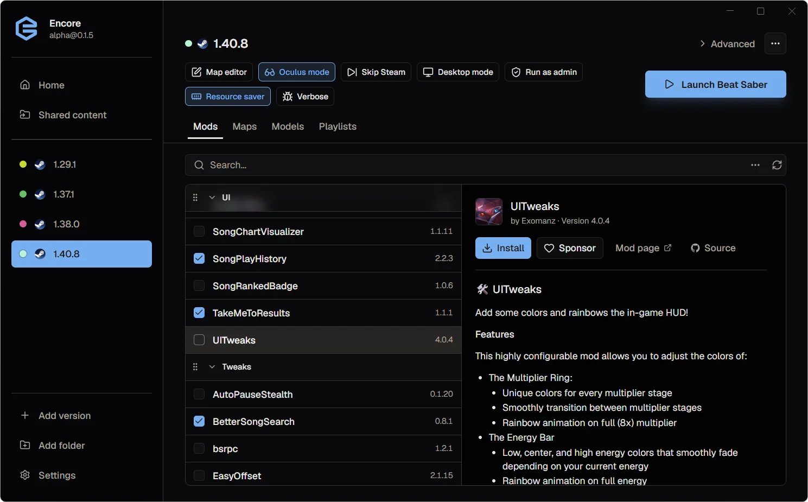

<p align="center">
   <a href="https://encore.scoresaber.com">
      
   </a>
</p>



## Download

Grab the latest build for your platform from [encore.scoresaber.com](https://encore.scoresaber.com) or [Releases](https://github.com/ScoreSaber/encore/releases/latest)

### Install from the terminal (optional)

On Linux, macOS or the Steam Frame you can skip the download and run this in a terminal instead:

```sh
curl -fsSL https://encore.scoresaber.com/install.sh | sh
```

This installs the latest Encore for your system and launches it

### Nix (optional)

Run Encore directly using flakes:

```sh
nix run github:ScoreSaber/encore
```

Or add the flake to your config:

```nix
inputs = {
  encore.url = "github:ScoreSaber/encore";
  encore.inputs.nixpkgs.follows = "nixpkgs";
};

# Using the package directly
environment.systemPackages = [ inputs.encore.packages.${pkgs.stdenv.hostPlatform.system}.default ];

# or using the overlay
nixpkgs.overlays = [ inputs.encore.overlays.default ];
environment.systemPackages = [ pkgs.encore ];
```

## Getting Started

See [.github/setup.md](.github/setup.md) for the local development guide

## Docs

[encore.scoresaber.com/docs](https://encore.scoresaber.com/docs)

## Contributing

See [.github/CONTRIBUTING.md](.github/CONTRIBUTING.md) for code standards and pull request expectations
